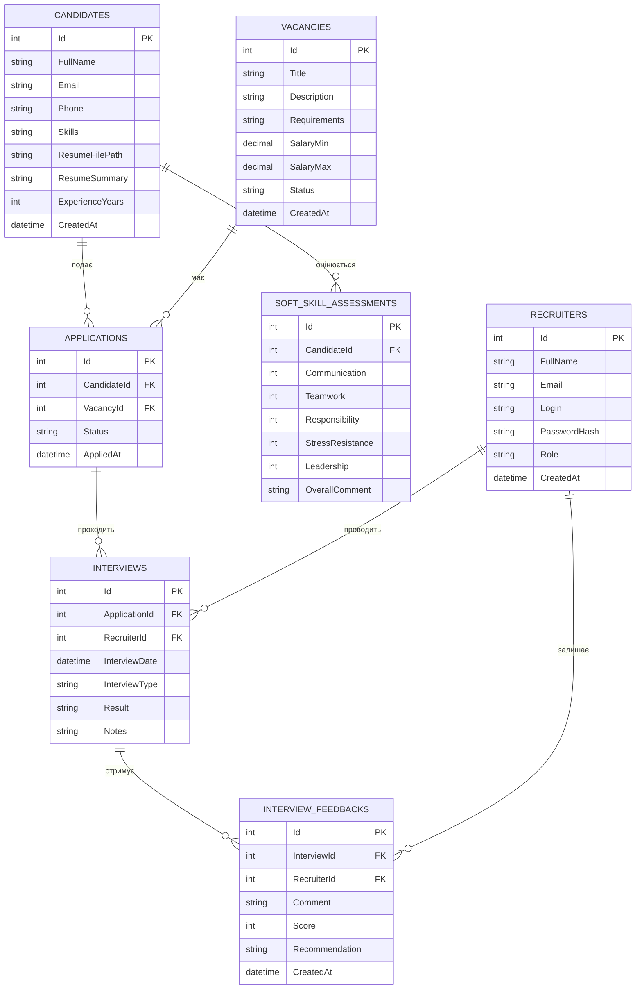
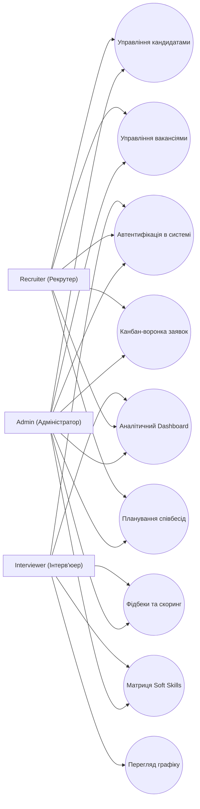

# HRReserveSystem — Архітектурна специфікація та структура даних

## 🏛️ Огляд системи

**HRReserveSystem** — повнофункціональна веб-система управління кадровим резервом та автоматизації рекрутингового циклу (ATS — Applicant Tracking System). Платформа забезпечує централізоване ведення бази талантів, багаторівневу воронку кандидатів, інтерактивний розклад співбесід, оцінку soft skills, персистентне сховище резюме та строгий аудит операцій.

---

## 🗄️ ER-діаграма бази даних (Entity-Relationship)

---

## 👥 Рольова модель доступу (RBAC Use Case)

---

## 📐 Архітектурні шари

Проєкт реалізовано за патерном **Layered MVC / Service Layer**:

- **Presentation Layer (MVC & REST API):** 
  - ASP.NET Core MVC контролери з підтримкою Razor Views для серверного рендерингу.
  - RESTful API контролери для програмної інтеграції (`/api/candidates`, `/api/vacancies`, `/api/applications`, `/api/interviews`, `/api/soft-skills`).
- **Business Logic Layer (Services):**
  - `ICareersService` — публічний портал кар'єри та обробка зовнішніх відгуків кандидатів.
  - `IDashboardService` — агрегація ключових HR-метрик та щотижневої динаміки.
  - `IAuditLogService` — незмінний журнал аудиту дій користувачів та подій безпеки.
  - `IGoogleCalendarSyncService` — синхронізація співбесід з Google Calendar та експорт у `.ics`.
  - `IEmailNotificationService` — транзакційне сповіщення з підтримкою патерну Transactional Outbox (`EmailOutbox`).
- **Data Access Layer:**
  - `ApplicationDbContext` (Entity Framework Core 8) з підтримкою подвійного провайдера: **PostgreSQL 16** для продакшену та **SQLite** для автономної розробки та in-memory integration-тестування.
- **Security & Infrastructure:**
  - ASP.NET Core Identity з Cookie-автентифікацією, хешуванням паролів (PBKDF2 / Argon2), анти-CSRF захистом, IP-rate limiting для публічних форм та заголовками OWASP (HSTS, CSP, X-Frame-Options).

---

## 📊 Реєстр таблиць бази даних

| Таблиця | Опис та призначення |
| :--- | :--- |
| `Candidates` | Каталог талантів кадрового резерву: контакти, стек навичок, досвід, посилання на резюме. |
| `Vacancies` | Відкриті позиції компанії, вимоги, зарплатні вилки (`numeric(18,2)`), ліміти та статуси. |
| `Applications` | Кандидатські заявки у воронці найму (статуси: `New`, `Screening`, `Interview`, `TestTask`, `Offer`, `Hired`, `Rejected`). |
| `Interviews` | Співбесіди: дати, формати (онлайн/офлайн), результати та відповідальні інтерв'юери. |
| `InterviewFeedbacks` | Зворотний зв'язок: текстова рецензія, числова оцінка (1–10) та фінальна рекомендація. |
| `SoftSkillAssessments` | 5-факторний скоринг soft skills кандидата: комунікація, командна робота, відповідальність, стресостійкість, лідерство. |
| `Recruiters` | Облікові записи персоналу компанії з прив'язкою до ролей доступу. |
| `AuditLogs` | Системний журнал аудиту: час, користувач, IP, тип операції, статус. |
| `AppNotifications` | Внутрішні сповіщення для користувачів системи про оновлення статусів та інтерв'ю. |

---

## 📸 Інтерфейс системи

Всі скріншоти системи розташовані у каталозі `docs/screenshots/`:

| Сторінка | Зображення |
| :--- | :--- |
| **Автентифікація** |  |
| **Аналітичний Dashboard** |  |
| **Реєстр кандидатів** |  |
| **Графік співбесід** |  |
| **Оцінка Soft Skills** |  |
