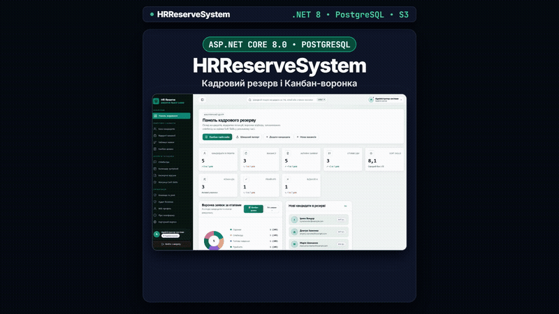
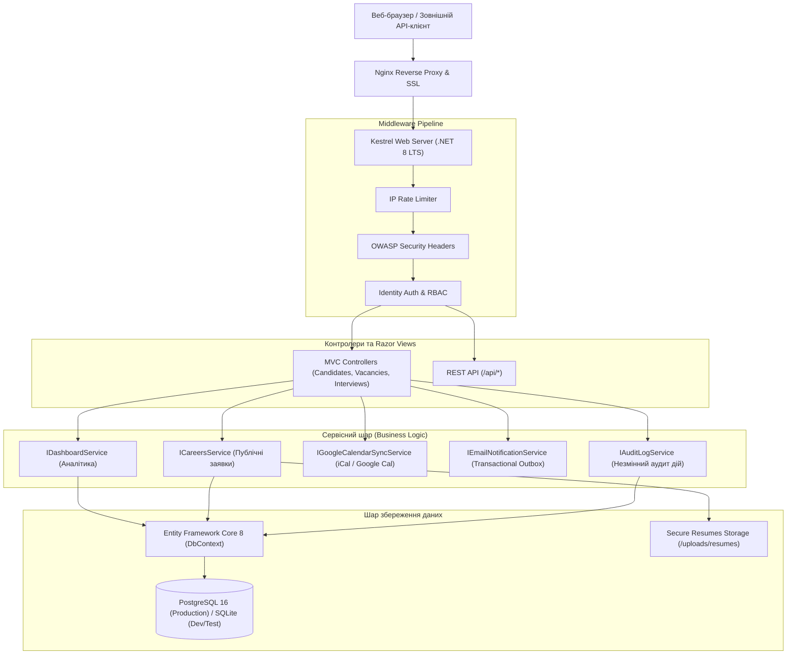
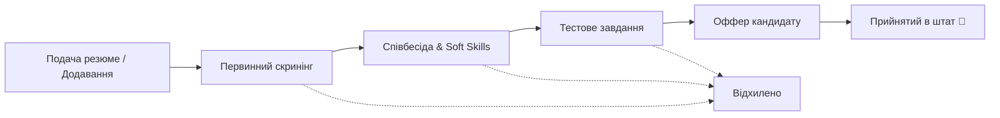
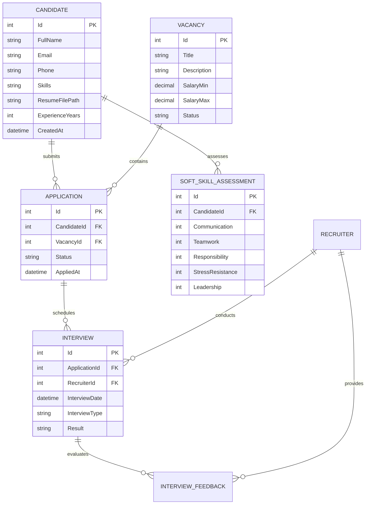

# HRReserveSystem — Enterprise Talent Acquisition & HR Reserve Management Platform

[](https://dotnet.microsoft.com/)
[](https://github.com/NoobITafk/HRReserveSystem/actions/workflows/ci.yml)
[](https://learn.microsoft.com/en-us/dotnet/csharp/)
[](https://www.postgresql.org/)
[](https://www.docker.com/)
[](https://xunit.net/)
[](https://hrreservesystem.duckdns.org)
[](LICENSE)

Сучасна, масштабована платформа промислового рівня для автоматизації повного циклу рекрутингу та управління кадровим резервом (**ATS — Applicant Tracking System**), побудована на стеку **ASP.NET Core 8 (.NET 8 LTS)** та **Entity Framework Core 8**.

---

## 🌐 Живий продакшн (Live Demo)

Система розгорнута на виділеному сервері під керуванням Nginx Reverse Proxy з автоматичним SSL (Let's Encrypt):

🔗 **[https://hrreservesystem.duckdns.org](https://hrreservesystem.duckdns.org)**

### Демо-доступи:

| Роль | Логін | Пароль | Сфера відповідальності |
| :--- | :--- | :--- | :--- |
| **Admin** | `admin` | `admin123` | Повний доступ до вакансій, кандидатів, аналітики, аудиту та персоналу |
| **Recruiter** | `recruiter` | `recruiter123` | Управління кандидатами, вакансіями, воронкою відбору та співбесідами |
| **Interviewer** | `interviewer` | `interviewer123` | Календар інтерв'ю, внесення зворотного зв'язку та оцінка Soft Skills |

---

## 🎬 Демонстрація інтерфейсу (Silent Video Showcase)



> 📹 **Повний відеоролик високої чіткості (Full HD 1080p, без звуку):**  
> [Завантажити або переглянути Docs/hrreserve_demo_silent.mp4](Docs/hrreserve_demo_silent.mp4)

---

## 🌟 Ключові можливості платформи

- **📋 Інтерактивна Канбан-дошка (Candidate Pipeline):**
  - Візуалізація етапів рекрутингу (`New` $\rightarrow$ `Screening` $\rightarrow$ `Interview` $\rightarrow$ `TestTask` $\rightarrow$ `Offer` $\rightarrow$ `Hired` / `Rejected`).
  - Миттєве перетягування карток через Drag-and-Drop з AJAX-синхронізацією стану (`POST /MoveStage`).
- **👤 Профіль кандидата та резюме:**
  - Повний життєвий цикл кандидата, детальний стек навичок, історія подач та комунікацій.
  - Безпечне завантаження резюме (`.pdf`, `.doc`, `.docx` до 5 MB) зі збереженням під унікальним `GUID` та захищеним завантаженням.
  - CSV експорт бази талантів з фільтрацією за досвідом та ключовими навичками.
- **📅 Планування співбесід та календарна синхронізація:**
  - Фіксація дат, типу зустрічі (технічна, ейчар, фінальна), призначеного рекрутера та результату.
  - Автоматична генерація посилань на Google Calendar та експорт подій у форматі `.ics` (iCalendar RFC 5545).
- **⭐ Багаторівнева оцінка Soft Skills:**
  - 5-факторний вектор оцінки: *Комунікація*, *Командна робота*, *Відповідальність*, *Стресостійкість*, *Лідерство* (шкала 1–10).
  - Автоматичний розрахунок зведеного індексу кандидата та візуалізація матриці компетенцій.
- **💬 Фідбеки інтерв'юерів та скоринг:**
  - Структуровані відгуки після кожного етапу з фіксацією рекомендацій (`Hire`, `Strong Hire`, `Hold`, `Reject`).
- **📨 Transactional Outbox & Email Notifications:**
  - Гарантована доставка сповіщень через патерн Transactional Outbox (`EmailOutbox` з fallback у разі недоступності SMTP).
- **🔒 Безпека промислового рівня (OWASP Compliance):**
  - Автентифікація через ASP.NET Core Identity з безпечними HttpOnly/SameSite cookies та PBKDF2 хешуванням.
  - Захист від CSRF (Anti-Forgery Tokens), Rate Limiting для публічних форм прийому заявок (`/Careers/Apply`).
  - Незмінний аудит-лог дій користувачів (`AuditLogs`) з прив'язкою IP-адреси, часу та типу дії.

---

## 🏛️ Архітектура системи



---

## 🔄 Життєвий цикл кандидата (Recruitment Funnel)



---

## 🗄️ Схема бази даних (ER Diagram)

Детальний опис сутностей та зв'язків доступний у [Docs/ARCHITECTURE.md](Docs/ARCHITECTURE.md).



---

## 🧪 Автоматизоване тестування (CI Quality Gate)

Рішення має повне покриття інтеграційними тестами на базі `xUnit` та `WebApplicationFactory`.

```bash
dotnet test --verbosity normal
```

```text
Passed!  - Failed: 0, Passed: 80, Skipped: 0, Total: 80, Duration: 25 s - HRReserveSystem.Tests.dll (net8.0)
```

Перевірені сценарії:
- Автентифікація, cookie lifecycle та розмежування прав за ролями (`Admin`, `Recruiter`, `Interviewer`).
- Повний цикл подачі заявки кандидатом через публічний портал `/Careers` з IP Rate Limiter.
- Безпека завантаження резюме (відхилення `.exe` та файлів > 5 MB, GUID-санітизація).
- Усунення колізій та обробка конкурентних запитів.
- Валідація валідності DTO у REST API (відсутність витоку парольних хешів).
- Робота Transactional Outbox та генерація `.ics` календарних файлів.

---

## 🚀 Швидкий запуск

### Варіант 1: Docker Compose

```bash
docker compose up -d
```
Сервіс доступний за адресою: `http://localhost:5000`.

### Варіант 2: .NET 8 CLI

```bash
dotnet restore
dotnet build
dotnet run --configuration Release
```

Детальні інструкції дивіться у [LAUNCH.md](LAUNCH.md) та [DEPLOYMENT.md](DEPLOYMENT.md).

---

## 📄 Ліцензія

Проєкт поширюється під ліцензією [MIT](LICENSE).
